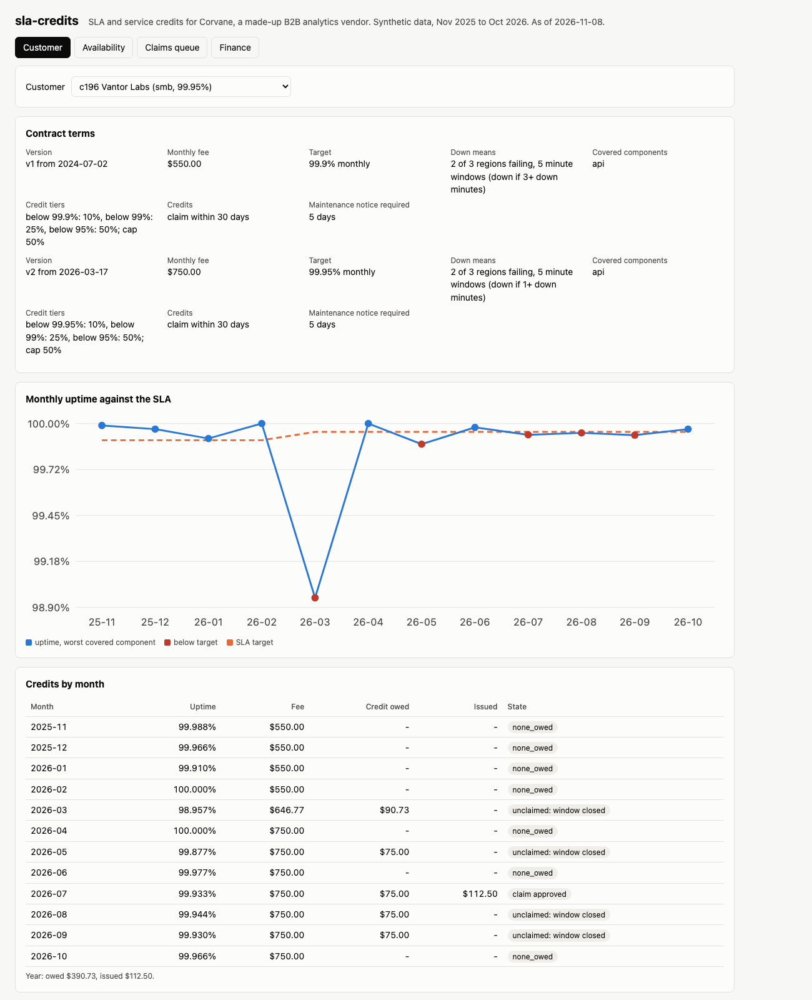
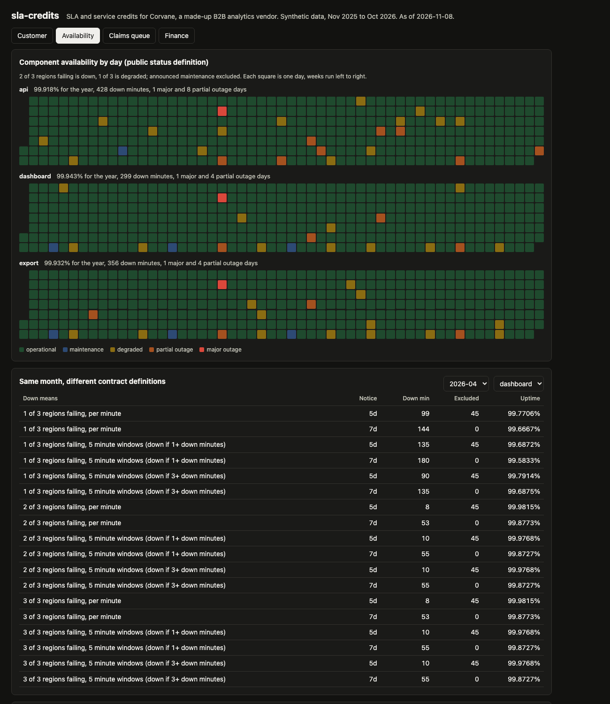
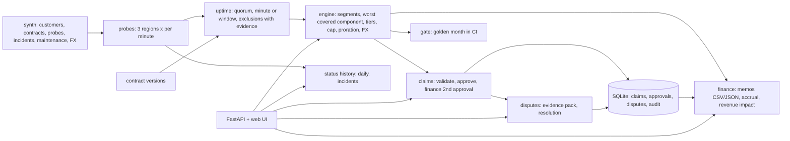

# sla-credits

An SLA and service credit engine for Corvane, a made-up B2B analytics SaaS vendor. It turns a year of per-minute monitoring into contract-accurate uptime for 300 customers, computes the service credits each contract owes, runs claims through validation and approval, handles disputes with an evidence pack, and gives finance credit memo exports, an accrual estimate, and revenue impact by segment. The public status history is derived from the same probes.



| Result (seed 20261, as of 2026-11-08) | Number |
|---|---|
| Tests | 110 passing in about 4 seconds |
| Customers | 300 (150 SMB, 105 mid-market, 45 enterprise), 39 with a mid-month contract change, USD, EUR and GBP |
| Monitoring | 12 months (Nov 2025 to Oct 2026), 3 components, 3 regions, per-minute probes; 43 incident records, 13 maintenance windows |
| Contract fees for the year | $65,626,096 (USD at monthly rates) |
| Credits owed by the contracts | $4,198,047 over 1,094 customer months below target |
| Credits issued (memos) | $3,858,730, 5.88% of fees: enterprise $3,618,158 (proactive), mid-market $226,795, SMB $13,777 |
| Owed but never claimed in the window | $324,423 (SMB $37,300, mid-market $287,123) |
| Accrual for credits not yet issued | $19,286 (open claims $9,938, unclaimed with the window open $9,349) |
| Claims | 386 filed: 276 approved, 45 rejected (SLA met or reviewer), 55 failed validation, 1 pending review, 4 pending finance, 5 disputed |
| Disputes | 84 opened: 50 upheld at the measured figure, 26 goodwill credit, 3 customer figure accepted, 5 open |
| Credit gate | March 2026 recomputed for all 300 customers in CI; 0 unexplained changes |

## Why

An SLA is a contract, not a dashboard number. Two customers looking at the same outage can be owed different money: one contract says a minute is down when any region fails, another needs 2 of 3. One measures per minute, another in 5 minute windows where a single bad minute takes the whole window. Maintenance is excluded only if it was announced far enough ahead, and the notice period differs by contract. Some customers are credited automatically, others must claim within 30 days, and an unclaimed credit is forfeited. Customers dispute the measured figure, finance needs a memo per customer in its own currency, and someone has to estimate the credits that will still arrive. Getting any of these wrong is a billing error with a customer's name on it.

| Problem | How it is handled | Where |
|---|---|---|
| "Down" means different things per contract | Quorum (1, 2 or 3 of 3 regions) and measurement (per minute, or 5 minute windows down at 1+ or 3+ bad minutes) are contract fields | `probes.py`, `uptime.py` |
| Exclusions need evidence | Maintenance excluded only if notice days >= the contract's requirement; overruns past the window count. Force majeure excluded for all; customer-caused incidents only for that customer. Every candidate is listed with applied or not, and why | `uptime.py` |
| Rounding into compliance | Uptime is an exact fraction; tier thresholds compare fractions, never floats | `uptime.py`, `credits.py` |
| Mid-month contract changes | The month splits into segments at day boundaries. Each segment uses its own terms, and its fee is prorated by day | `uptime.py`, `engine.py` |
| Claims | Validation: month closed, inside the claim window, covered component, not proactive, not a duplicate. Approval: support, plus a second approver in finance at $1,500 or more | `claims.py` |
| Disputes | A claim more than 5 minutes above measured opens a dispute with an evidence pack. Resolution: upheld, goodwill (within the cap), or accepted | `claims.py` |
| Money moving by accident | A golden file pins March 2026. CI fails if any customer's credit changes while its contract and the data fingerprint did not | `gate.py` |
| Audit | Every submission, approval, rejection, dispute and export is written to an append-only audit table (triggers block UPDATE and DELETE) | `store.py` |

## Worked example: one customer's month

Vantor Labs (c196, SMB, USD) amended its contract on March 17, 2026: fee $550 to $750, target 99.9% to 99.95%, and the 5 minute window rule went from "3+ bad minutes" to "any bad minute". The major incident of the year (storage failover, 190 minutes in all regions) started the same afternoon. Output of `slacredits month c196 2026-03`:

```
c196 Vantor Labs (smb, USD), 2026-03, credit basis: claim_required
  contract v1 from 2026-03-01, 16 of 31 days: target 99.9%, 2 of 3 regions failing, 5 minute windows (down if 3+ down minutes)
    api       raw down    3 min, counted    0 min, uptime (23040 - 0) / 23040 = 100.0000%
    worst covered component: api at 100.0000% -> tier 0%
    fee $550.00 x 16/31 = $283.87; credit 0% = $0.00
  contract v2 from 2026-03-17, 15 of 31 days: target 99.95%, 2 of 3 regions failing, 5 minute windows (down if 1+ down minutes)
    api       raw down  238 min, counted  225 min, excluded 20 min (MW-2026-03), uptime (21580 - 225) / 21580 = 98.9574%
    worst covered component: api at 98.9574% -> tier 25%
    fee $750.00 x 15/31 = $362.90; credit 25% = $90.73
  total credit $90.73 (USD 90.73 at 1.0)
```

The 20 minute maintenance window on March 22 was announced 7.16 days ahead, more than the 5 days this contract requires, so it is excluded from both downtime and the eligible minutes. Uptime fell below 99.0%, so the second tier (25%) applies to the prorated fee of the second segment only. Vantor Labs never filed a claim for March, so on April 30 the $90.73 was forfeited.

### Same month, different definitions

April 2026, dashboard (`slacredits compare 2026-04 --component dashboard`). The maintenance window that month was announced 6.14 days ahead: excluded under a 5 day notice clause, downtime under a 7 day clause.

| Down means | Notice clause | Downtime | Uptime |
|---|---|---:|---:|
| 2 of 3 regions, per minute | 5 days | 8 min | 99.9815% |
| 2 of 3 regions, per minute | 7 days | 53 min | 99.8773% |
| 2 of 3 regions, 5 minute windows (1+ bad minute) | 7 days | 55 min | 99.8727% |
| 1 of 3 regions, per minute | 7 days | 144 min | 99.6667% |
| 1 of 3 regions, 5 minute windows (1+ bad minute) | 7 days | 180 min | 99.5833% |

Same probes, same month: 99.98% for one customer, 99.58% for another.

## The year's credits

| Segment | Customers | Fees (USD) | Owed | Issued | Forfeited | Issued % of fees |
|---|---:|---:|---:|---:|---:|---:|
| SMB (99.9%, claim) | 150 | $2,870,432 | $50,392 | $13,777 | $37,300 | 0.48% |
| Mid-market (99.9 or 99.95%, claim) | 105 | $14,441,433 | $529,498 | $226,795 | $287,123 | 1.57% |
| Enterprise (99.95 or 99.99%, proactive) | 45 | $48,314,231 | $3,618,158 | $3,618,158 | $0 | 7.49% |
| Total | 300 | $65,626,096 | $4,198,047 | $3,858,730 | $324,423 | 5.88% |

Credits issued by service month (USD): Nov $122,432, Dec $181,675, Jan $420,907 (emergency api maintenance with 1 day of notice), Feb $59,583, Mar $543,591 (the major incident), Apr $538,610, May $581,401, Jun $167,606, Jul $447,444, Aug $179,667, Sep $449,970, Oct $165,844. Full numbers: [docs/summary.json](docs/summary.json).

What the numbers show:
- **Proactive enterprise contracts carry almost all the cost.** They are 74% of fees and 94% of credits issued, mostly from 99.99% and "any region" contracts, where 5 minutes of downtime is a breach.
- **Claim-required credits are mostly not collected.** Of $579,890 owed to SMB and mid-market customers, $240,572 was issued and $324,423 was forfeited because no claim arrived in the window. The synthetic claim rates are 30% (SMB) and 50% (mid-market); the accrual uses the same rates.
- **Notice periods matter.** A 6 day notice moves 45 minutes into downtime for every 7 day contract.

The outage rates are synthetic. I tuned blip counts, outage lengths and maintenance notice so the year has a mix of quiet and bad months; with my first settings almost every customer was credited every month, which is not believable. A 5.88% credit rate is still high for a real vendor; it reflects the share of strict enterprise contracts here.



## Architecture



Monitoring and contracts are regenerated from the seed in about 0.05 seconds; the year's credit calculation takes about 0.6 seconds. Only human decisions (claims, approvals, disputes, the audit log) are stored. A customer's monthly uptime is the worst covered component in each contract segment.

## How to run

```bash
cd sla-credits
uv sync --python 3.12
uv run pytest -q                                   # 110 tests, about 4 seconds
uv run slacredits api --port 8874                  # UI at http://127.0.0.1:8874/
uv run slacredits month c196 2026-03               # the worked example
uv run slacredits compare 2026-04 --component dashboard
uv run slacredits totals                           # the year's credits by segment
uv run slacredits export 2026-03 --format csv      # credit memos for one service month
uv run slacredits gate                             # the CI credit gate
make screenshot                                    # with the API running; uses headless Chrome
```

API, all JSON unless noted: `GET /v1/customers`, `/v1/customers/{id}`, `/v1/customers/{id}/uptime`, `/v1/customers/{id}/uptime/{month}` (with exclusions), `/v1/customers/{id}/credits`, `/v1/credits?month=`, `/v1/compare?month=&component=`, `/v1/claims`, `POST /v1/claims`, `POST /v1/claims/{id}/approve`, `POST /v1/claims/{id}/reject`, `/v1/disputes`, `/v1/disputes/{id}/evidence`, `POST /v1/disputes/{id}/resolve`, `/v1/finance/memos?month=&format=json|csv`, `/v1/finance/accrual`, `/v1/finance/revenue-impact`, `/v1/status`, `/v1/status/history`, `/v1/status/heatmap`, `/v1/incidents`, `/v1/audit`, `/healthz`, `/metrics` (Prometheus text). Logs are one JSON line per request with a request id.

Docker is not installed on the machine this was built on. The Dockerfile (slim, multi-stage, non-root, HEALTHCHECK) and the image smoke test are built and run in GitHub Actions, along with ruff, the tests, and the credit gate.

## Tests

110 tests: probe aggregation (1, 2, 3 of 3 regions, per minute vs 5 minute windows, excluded minutes inside windows), maintenance exclusion at, above and below the notice period, overruns, force majeure and customer-caused exclusions, exact uptime math, tier boundaries at exactly the target, caps, proration and half-up rounding, mid-month segments, claim window edges (last day accepted, next day rejected), uncovered components, duplicates, the two-approver rule, dispute evidence pack contents (timeline counts equal measured minutes), all three resolutions, credit memo CSV and JSON totals, proactive issue dates, accrual categories and claim rates, revenue impact totals, status history derivation, the gate (passes on committed data, fails on a code change that moves one cent, explains contract and data changes), the append-only audit log, and the API end to end.

## Production notes

- Probes would come from a time series store (per-minute results per region), and down minutes would be computed per definition in a nightly batch and stored, not regenerated.
- Contracts would come from the CRM or CPQ system with versioned terms; the engine would read the version effective on each day, as it does here.
- The credit memos would post to the billing system as credit notes against the next invoice, with the memo id as an idempotency key.
- Claim rates for the accrual should be fitted from real claim history per segment and refreshed quarterly; here they are fixed at 30% and 50%.
- The golden month gate would cover several months and run on every change to the engine, the contract loader, or the probe pipeline.
- Approvers would come from SSO with roles, not from a request body.

## License

MIT. See [LICENSE](LICENSE).
